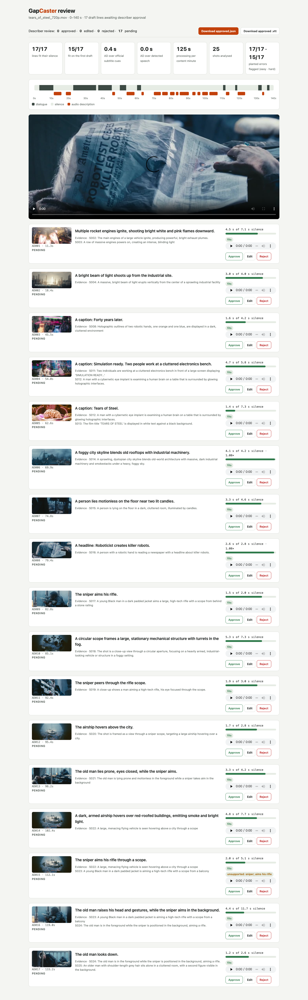
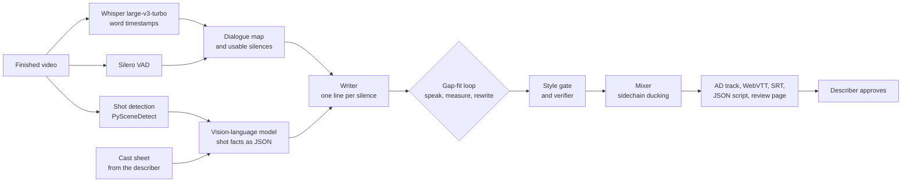

# GapCaster

**Offline audio description that fits the silences.**

GapCaster drafts an audio-description (AD) track for a finished video. It finds every silence between lines of dialogue, writes narration sized for each one, speaks it, measures it, and rewrites it until it fits. Every line comes with the evidence behind it, and a human describer approves the result. Everything runs locally on open models.



Built for the **ASUS UGen AI League 2026** · Theme: Creator AI · Battlefield Thunderstorm. The Stage I prototype runs on a laptop; the Stage II target is one **ASUS UGen Intel Arc Pro B70 (32 GB)**.

## Results (Stage I, laptop prototype)

Measured on an Apple M5 Max laptop, not on a B70 yet. Demo content: *Tears of Steel* (Blender Foundation, CC BY 3.0).

| Tears of Steel | 0:00–2:20 | Full film |
|---|---:|---:|
| Programme analysed | 140 s | 734 s |
| Shots · dialogue spans · usable silences | 25 · 9 · 9 | 130 · 63 · 44 |
| **Lines that fit their silence** | **17/17** | **70/71** |
| …first draft · rescued by speed ladder · by rewrite | 15 · 2 · 0 | 60 · 2 · 5 |
| **Narration over official subtitle cues¹** | **0.4 s** | **5.8 s** |
| Narration over detected speech (internal check) | 0.0 s | 0.0 s |
| **Manual frame check: accurate · minor · wrong²** | **13 · 4 · 0** | — |
| Verifier: easy planted errors flagged³ | 17/17 | 40/40 |
| Verifier: hard in-film errors flagged³ | 15/17 | 34/40 |
| Verifier false alarms on clean lines | 1/17 | 5/40 |
| Processing per content minute | 125 s | 137 s |
| Peak model memory | 33 GB | 34 GB |

¹ The film's official subtitles are an independent reference. Cues are rounded to whole seconds and stay on screen after a line ends, so most of the overlap sits at cue tails. In the full film about 1.4 s falls in cues where neither detector heard speech (short shouts under loud music).
² Every excerpt line compared with the frame at its midpoint: [`eval/spotcheck_tears_of_steel_0-140.csv`](eval/spotcheck_tears_of_steel_0-140.csv).
³ Easy: an absurd detail appended to a finished line. Hard: a noun, verb or character borrowed from another shot of the same film, or the line written for a neighbouring silence. The verifier checks each line against the facts of the shots on screen while it plays; perception errors already in those facts are left to the cast sheet and the human reviewer.

Sample outputs from the 140-second run are in [`samples/tears-of-steel-0-140`](samples/tears-of-steel-0-140): the description script ([`ad_script.txt`](samples/tears-of-steel-0-140/ad_script.txt)), a WebVTT `kind="descriptions"` track, SRT, the full JSON script with provenance, and the review page.

## How it works



1. **Map the silences.** Two independent detectors: Whisper word timestamps (low-confidence shouts are kept; only known Whisper artefacts such as repetition loops are dropped) and Silero VAD. A moment counts as dialogue if either hears speech; pauses under 0.6 s stay inside a span. A silence is usable from 0.25 s after a line ends to 0.30 s before the next starts. Long silences are split at shot cuts.
2. **Read every shot.** A vision-language model returns JSON facts for each shot: who, where, action, on-screen text, the key visual fact and a confidence score. A short cast sheet written by the describer keeps names consistent; each entry can carry a `named_from` time, and before it the person is described by look, as AD guidelines advise.
3. **Write to budget.** One line per silence, with a word budget of ⌊silence × 2.6 words/s⌋ (3 to 18 words). The writer sees only the shots on screen during the silence. Unread story text (title cards, headlines), including text from the shot that just cut away, is queued and must be read; credits and logos never are.
4. **Gap-fit loop.** Kokoro TTS speaks the line and the trimmed audio gives its real duration. If it overflows, the line is tried at 1.08× and 1.15× speed, then the writer is told the exact overflow and asked for a shorter line (up to three rounds).
5. **Style gate.** Deterministic rules from professional AD practice block camera language ("we see"), speculation ("seems", "maybe") and first person, and flag inner-state or evaluative words. Lines that repeat the last two are dropped.
6. **Verify, review, mix.** A verifier checks each line against the facts of the shots on screen while it plays and flags unsupported claims. ffmpeg mixes the narration over the programme with sidechain ducking. On the review page the describer approves, edits or rejects each line; `gapcaster export --approved approved.json` re-mixes only approved lines and re-times edited ones.

## Quick start

Requirements: Python 3.11+, `ffmpeg` on PATH. The Stage I backend needs Apple Silicon (MLX).

```bash
uv venv --python 3.11 && source .venv/bin/activate
uv pip install -e ".[mac]"

gapcaster run film.mp4 --out runs/demo --cast configs/cast_tears_of_steel.yaml \
  --start 0 --end 140 --ref-srt subtitles.srt --inject 20
open runs/demo/review.html
```

Each stage can switch runtime. For an Intel Arc Pro B70 (or any machine without Apple Silicon):

```bash
uv pip install -e ".[intel]"
# vLLM / Intel llm-scaler serving the model as "qwen" (--served-model-name qwen)
gapcaster run film.mp4 --out runs/b70 --backend openai --base-url http://<server>:8000/v1 --model qwen \
  --concurrency 8 --asr openvino --asr-device GPU --tts kokoro
```

| Stage | `mlx` (Stage I laptop) | Portable runtime | Status of the portable runtime |
|---|---|---|---|
| Vision-language model | mlx-vlm, in-process | any OpenAI-compatible server (`--backend openai`, `--concurrency`) | client implemented; Stage II validation on the B70 |
| Speech recognition | mlx-whisper | OpenVINO GenAI WhisperPipeline (`--asr openvino`, CPU or GPU) | runs on a laptop CPU: dialogue map IoU 0.835 against MLX |
| Text-to-speech | mlx-audio Kokoro | PyTorch Kokoro (`--tts kokoro`, CPU or XPU) | runs on a laptop CPU: line durations within 33 ms of MLX |

`python eval/parity.py runs/<run>` reproduces the speech-path comparison. Set `GAPCASTER_VLM` to use a model folder that is already on disk.

## Outputs

| File | What it is |
|---|---|
| `clip_with_ad.mp4` | Programme with the description mixed in |
| `ad_track.wav` | Description voice only, time-aligned |
| `ad.vtt` | WebVTT text track, `Kind: descriptions` |
| `ad.srt`, `ad_script.txt` | Script with timings |
| `script.json` | Everything: shots and their facts, dialogue map, silences, every draft, timings, flags, metrics |
| `review.html` | Review page: evidence per line; Approve, Edit, Reject; download `approved.json` and an approved WebVTT |
| `approved/` | After `gapcaster export --approved`: the re-mixed programme and tracks with only approved lines |

## Stage II: one ASUS UGen Intel Arc Pro B70

The orchestrator stays the same; the models move to the card.

| Component | Stage I (laptop) | Stage II (Arc Pro B70) | Licence |
|---|---|---|---|
| Vision-language model | Qwen3.8-27B, 8-bit MLX, in-process | Qwen3.8-27B on Intel llm-scaler-vllm 1.5 (online INT4, FP8 KV cache); fallback Qwen3-VL-8B | Apache-2.0 |
| Speech recognition | Whisper large-v3-turbo (MLX) | Whisper large-v3-turbo (OpenVINO GenAI, word timestamps) | MIT |
| Voice activity detection | Silero VAD | Silero VAD | MIT |
| Text-to-speech | Kokoro-82M (mlx-audio) | Kokoro-82M (PyTorch, CPU or XPU) | Apache-2.0 |
| Shot detection | PySceneDetect | PySceneDetect on hardware-decoded frames | BSD-3-Clause |
| Media | ffmpeg | ffmpeg with QSV / VA-API decode on the card's media engines | external tool |

Planned residency on one 32 GB card (estimate, to be measured): Qwen3.8-27B INT4 with FP8 KV cache, vLLM capped at 0.70 (≈ 23 GB) · Whisper large-v3-turbo (≈ 2.5 GB) · Kokoro-82M (≤ 1 GB) · runtime contexts (≈ 2 GB) → **≈ 28.5 GB**. Intel's published Qwen3.8-27B recipe uses two GPUs, so single-card INT4 with image input is a Stage II experiment; the fallback puts shot facts on Qwen3-VL-8B or 30B-A3B (both in llm-scaler's vision-language list).

Three ways to deploy one card: an **overnight queue** (full card, shot facts batched through vLLM), **describer seats** (the B70 supports up to 4 SR-IOV virtual GPUs; each runs a lean ≈ 7 GB profile of Qwen3-VL-8B INT4 + Whisper INT8 for interactive redrafts), and a **two-card studio** (64 GB, parallel language tracks).

Stage II measurements: processing time per content minute, throughput against concurrency, peak VRAM, energy per content minute, describer edit time against writing from scratch, and ratings from blind and low-vision listeners.

## Project layout

```
gapcaster/      pipeline: media, scenes, gapmap (Whisper MLX/OpenVINO + VAD), llm (MLX + OpenAI
                backends), tts (MLX/PyTorch), prompts, styleguard, inject, pipeline, export,
                review, approve, cli
eval/           parity check for the portable speech path; manual frame spot-check
configs/        cast sheet for the demo film
samples/        outputs of the 140-second demo run
tests/          unit tests (pytest)
```

## Credits and licences

- Code: MIT, © 2026 Ted Chen.
- Demo footage and frames: *Tears of Steel* © Blender Foundation | mango.blender.org, licensed CC BY 3.0. Official subtitles are used only for evaluation.
- Models: Qwen3.8-27B (Apache-2.0), Whisper large-v3-turbo (MIT), Silero VAD (MIT), Kokoro-82M (Apache-2.0). Voices are synthetic stock voices; no voice cloning.
- Libraries include MLX, mlx-vlm, mlx-audio, OpenVINO GenAI, PyTorch (BSD-3-Clause), PySceneDetect and spaCy. Kokoro's English G2P can fall back to espeak-ng (GPL-3.0), installed separately; ffmpeg is called as a subprocess.
