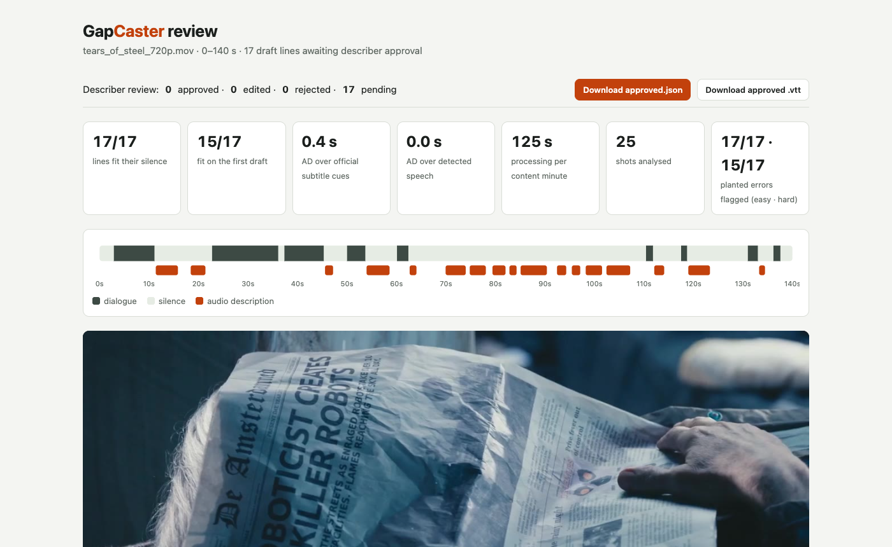
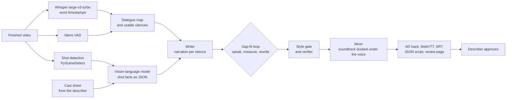

# GapCaster

**Offline audio description that fits the silences.**

GapCaster drafts an audio-description (AD) track for a finished video. It finds the silences between lines of dialogue, writes narration sized for each one, speaks it, measures it, and speeds it up slightly or rewrites it until it fits. Every line comes with the evidence behind it, and a human describer approves the result. Everything runs locally on open models.



Built for the **ASUS UGen AI League 2026** · Theme: Creator AI · Battlefield Thunderstorm. The Stage I prototype runs on a laptop; the Stage II target is one **ASUS UGen Intel Arc Pro B70 (32 GB)**. Built by Ted Chen with AI coding assistance (Claude, Anthropic).

## Results (Stage I, laptop prototype)

Measured on an Apple M5 Max laptop, not on a B70 yet. Demo content: *Tears of Steel* (Blender Foundation, CC BY 3.0). This film was also the development film: the prompts, filters and thresholds were tuned on it, so every number below is in-sample; a held-out film is a Stage II measurement. The numbers were produced by the code at tag [`stage1-results`](https://github.com/tedinroc/gapcaster/tree/stage1-results); later commits fix issues found in an audit (see Known limitations) and have not been re-measured yet.

| Tears of Steel | 0:00–2:20 | Full film |
|---|---:|---:|
| Programme analysed | 140 s | 734 s |
| Shots · dialogue spans · usable silences | 25 · 9 · 9 | 130 · 63 · 44 |
| **Lines that fit their silence⁴** | **17/17** | **70/71** |
| …first draft · speed ladder · length rewrite · style rewrite | 15 · 2 · 0 · 0 | 60 · 2 · 5 · 3 |
| **Narration over official subtitle cues¹** | **0.4 s** | **5.8 s** |
| Narration over detected speech (internal check) | 0.0 s | 0.0 s |
| **AI-assisted frame check: accurate · minor · wrong²** | **13 · 4 · 0** | — |
| Verifier: obvious planted errors flagged³ | 17/17 | 40/40 |
| Verifier: in-film word/character swaps flagged³ | 15/17 | 34/40 |
| Verifier flags on unmodified lines⁵ | 1/17 | 5/40 |
| Processing per content minute | 125 s | 137 s |
| Peak model memory | 33 GB | 34 GB |

¹ The film's official subtitles are an independent reference. Cues are rounded to whole or half seconds and stay on screen after a line ends, so part of the overlap sits at cue tails; in the full film about 1.4 s falls in cues where neither detector heard speech (short shouts under loud music), and one shout of about 0.8 s was only partly detected.
² Each excerpt line was compared with the frame at its midpoint by the AI assistant, one frame per line: [`eval/spotcheck_tears_of_steel_0-140.csv`](eval/spotcheck_tears_of_steel_0-140.csv). Human describer review is part of Stage II.
³ Obvious: an absurd detail appended to a finished line, or a character swapped. In-film: a noun, verb or character borrowed from another shot of the same film, or the line written for a neighbouring silence. The substitutes never appear in the shot facts, so these are still easier than real perception errors. The verifier checks each line against the facts of the shots on screen while it plays; perception errors already in those facts are left to the cast sheet and the human reviewer. The full-film rows cover the first 40 placed lines.
⁴ Every spoken line fits its silence. The one unplaced line in the full film read an on-screen quote containing "we", and the first-person rule wrongly held it back (a false positive since fixed: on-screen text read verbatim is now exempt).
⁵ The verifier's own flags on lines nobody corrupted. They are not all false alarms: the excerpt's single flag (AD015) is a real minor error in the frame check.

Sample outputs from the 140-second run are in [`samples/tears-of-steel-0-140`](samples/tears-of-steel-0-140): the description script ([`ad_script.txt`](samples/tears-of-steel-0-140/ad_script.txt)), a WebVTT `kind="descriptions"` track, SRT, the full JSON script with provenance, the review page ([`review.html`](samples/tears-of-steel-0-140/review.html), full screenshot [`docs/review.png`](docs/review.png)) and the mixed clip. The full film's script is in [`samples/tears-of-steel-full`](samples/tears-of-steel-full).

## How it works



1. **Map the silences.** Two independent detectors: Whisper word timestamps (low-confidence shouts are kept; only known Whisper artefacts such as repetition loops are dropped) and Silero VAD. A moment counts as dialogue if either hears speech; pauses under 0.6 s stay inside a span. A silence is usable from 0.25 s after a line ends to 0.30 s before the next starts. Long silences are split at shot cuts, and a silence can stay empty when nothing new is on screen, as AD guidelines advise.
2. **Read every shot.** A vision-language model returns JSON facts for each shot: who, where, action, on-screen text, the key visual fact and a confidence score. A short cast sheet written by the describer keeps names consistent; each entry can carry a `named_from` time, and before it the person is described by look.
3. **Write to budget.** Narration for each window, with a word budget of ⌊window × 2.6 words/s⌋ (3 to 18 words). Unread story text (title cards, headlines), including text from the shot that just cut away, is queued for the writer, and a draft that ignores it gets one forced rewrite. A pattern list keeps studio cards, credits and web addresses out of the narration.
4. **Gap-fit loop.** Kokoro TTS speaks the line and the trimmed audio gives its real duration. If it overflows, the line is tried at 1.08× and 1.15× speed, then the writer is told the exact overflow and asked for a shorter line (up to three rounds).
5. **Style gate.** Deterministic rules from professional AD practice block camera language ("we see"), speculation ("seems", "maybe") and first person, and flag inner-state words, evaluative words and similes. On-screen text read verbatim is exempt. Lines that repeat the last two are dropped.
6. **Verify, review, mix.** A verifier checks each line against the facts of the shots on screen while it plays and flags unsupported claims (no verdict is also flagged). ffmpeg mixes the narration in, with the soundtrack ducked under the voice. On the review page the describer approves, edits or rejects each line; `gapcaster export <run_dir> --approved approved.json` re-mixes only approved lines and re-times edited ones.

A real case from the 140-second run (`AD008`, silence of 2.75 s, budget 7 words): *A headline: Roboticist creates killer robots.* is 2.78 s at normal speed, so it is tried at 1.08× and fits at 2.64 s.

And the style gate at work in the full film (`AD001`): *A caption: Blender Foundation Presents.* is blocked (credits) and redrafted as *White text on black background.* (1.66 s, fits).

## Quick start

Requirements: an Apple Silicon Mac with at least 48 GB of unified memory (64 GB recommended; peak use is about 34 GB), about 35 GB of free disk (the first run downloads about 31 GB of models), Python 3.11–3.13, [uv](https://docs.astral.sh/uv/) and `ffmpeg` on PATH. You can inspect the sample outputs without any models: open `samples/tears-of-steel-0-140/review.html`.

```bash
uv venv --python 3.11 && source .venv/bin/activate
uv pip install -e ".[mac]"

# the demo film and its official subtitles (subtitles are used only for evaluation)
curl -LO https://download.blender.org/demo/movies/ToS/tears_of_steel_720p.mov
curl -LO https://download.blender.org/demo/movies/ToS/subtitles/TOS-en.srt

gapcaster run tears_of_steel_720p.mov --out runs/demo --cast configs/cast_tears_of_steel.yaml \
  --start 0 --end 140 --ref-srt TOS-en.srt --inject 20
open runs/demo/review.html
# after reviewing, download approved.json from the page, then:
gapcaster export runs/demo --approved approved.json
```

Each stage can switch runtime. For an Intel Arc Pro B70 on Linux, install the XPU build of PyTorch first so Kokoro can use the card:

```bash
uv pip install torch --index-url https://download.pytorch.org/whl/xpu
uv pip install -e ".[intel]"
# vLLM / Intel llm-scaler serving the model as "qwen" (--served-model-name qwen)
gapcaster run tears_of_steel_720p.mov --out runs/b70 --backend openai --base-url http://<server>:8000/v1 --model qwen \
  --concurrency 8 --asr openvino --asr-device GPU --tts kokoro
```

On Linux, OpenCV (pulled in by PySceneDetect) needs `libgl1`.

| Stage | `mlx` (Stage I laptop) | Portable runtime | Status of the portable runtime |
|---|---|---|---|
| Vision-language model | mlx-vlm, in-process | any OpenAI-compatible server (`--backend openai`, `--concurrency`) | client implemented and run against a local stand-in; Stage II validation on the B70 |
| Speech recognition | mlx-whisper | OpenVINO GenAI WhisperPipeline (`--asr openvino`, CPU or GPU) | runs on a laptop CPU: dialogue map IoU 0.835 against MLX (both include the shared VAD spans; speech-recognition-only IoU 0.77) |
| Text-to-speech | mlx-audio Kokoro | PyTorch Kokoro (`--tts kokoro`, CPU or XPU) | runs on a laptop CPU: line durations within 33 ms of MLX |

The whole portable path has also run end to end on a laptop: `--backend openai --concurrency 4` against the local stand-in server in `eval/local_server.py` (it serves one request at a time; it checks the code path, not throughput), with `--asr openvino --tts kokoro`, on a 50-second window (7/7 lines fit; [`samples/portable-path-e2e-metrics.json`](samples/portable-path-e2e-metrics.json)). Set `GAPCASTER_VLM` to use a model folder that is already on disk.

Tests and checks:

```bash
uv pip install -e ".[dev]" && pytest -q                 # unit tests; no models needed
uv pip install -e ".[mac,intel]"                         # Apple Silicon, both runtimes
python eval/parity.py runs/demo                          # MLX vs OpenVINO/PyTorch speech path
```

## Outputs

| File | What it is |
|---|---|
| `clip_with_ad.mp4` | Programme with the description mixed in |
| `ad_track.wav` | Description voice only, time-aligned |
| `ad.vtt` | WebVTT text track, `Kind: descriptions` |
| `ad.srt`, `ad_script.txt` | Script with timings |
| `script.json` | Everything: shots and their facts, dialogue map, silences, every draft, timings, flags, metrics |
| `review.html` | Review page: evidence per line; Approve, Edit, Reject; download `approved.json` and an approved WebVTT |
| `approved/` | After `gapcaster export`: the re-mixed programme and tracks with only approved lines |

## Known limitations

- The writer sees every shot in its silence, but a short line may finish before a later shot appears; in the full film 10 of 70 lines were written partly from such shots, and these account for about half the verifier's flags. Stage II rewrites a line from only the shots on screen while it plays.
- The text gate forces one rewrite; a later shortening for time can still drop the text (two cases in the full film).
- End-credit rolls slipped through the credits pattern in the full-film run; the pattern has since been extended.
- English only; Traditional Chinese narration is planned.
- Timings were measured on a laptop that was also running other jobs; Stage II re-times on an idle machine.

## Stage II: one ASUS UGen Intel Arc Pro B70

The orchestrator stays the same; the models move to the card.

| Component | Stage I (laptop) | Stage II (Arc Pro B70) | Licence |
|---|---|---|---|
| Vision-language model | Qwen3.8-27B, 8-bit MLX, in-process | Qwen3.8-27B on Intel llm-scaler-vllm 1.5 (online INT4, FP8 KV cache); fallback Qwen3-VL-8B | Apache-2.0 |
| Speech recognition | Whisper large-v3-turbo (MLX) | Whisper large-v3-turbo (OpenVINO GenAI, word timestamps) | MIT |
| Voice activity detection | Silero VAD | Silero VAD | MIT |
| Text-to-speech | Kokoro-82M (mlx-audio) | Kokoro-82M (PyTorch, CPU or XPU) | Apache-2.0 |
| Shot detection | PySceneDetect | PySceneDetect on hardware-decoded frames | BSD-3-Clause |
| Media | ffmpeg | ffmpeg with QSV / VA-API decode on the card's media engines | external tool |

Planned residency on one 32 GB card (estimate, to be measured): Qwen3.8-27B INT4 with FP8 KV cache, vLLM capped at 0.72 (≈ 23 GB) · Whisper large-v3-turbo (≈ 2.5 GB) · Kokoro-82M (≤ 1 GB) · runtime contexts (≈ 2 GB) → **≈ 28.5 GB**. Intel's published Qwen3.8-27B recipe uses two GPUs, so single-card INT4 with image input is a Stage II experiment; the fallback puts shot facts on Qwen3-VL-8B or 30B-A3B (both in llm-scaler's vision-language list).

Three ways to deploy one card: an **overnight queue** (full card, shot facts batched through vLLM), **describer seats** (the B70 supports up to 4 SR-IOV virtual GPUs; each could run a lean ≈ 7 GB profile of Qwen3-VL-8B INT4 + Whisper INT8 for interactive redrafts, if VRAM splits evenly, which Intel does not publish), and a **two-card studio** (64 GB, parallel language tracks).

Stage II measurements: processing time per content minute, throughput against concurrency, peak VRAM, energy per content minute, and small pilots of describer edit time and blind and low-vision listener ratings.

## Project layout

```
gapcaster/      pipeline: media, scenes, gapmap (Whisper MLX/OpenVINO + VAD), llm (MLX + OpenAI
                backends), tts (MLX/PyTorch), prompts, styleguard, inject, pipeline, export,
                review, approve, cli
eval/           parity check for the portable speech path; local OpenAI-compatible test server;
                AI-assisted frame check
configs/        cast sheet for the demo film
samples/        outputs of the 140-second demo run; full-film script and metrics;
                portable-path metrics
tests/          unit tests (pytest)
```

## Credits and licences

- Code: MIT, © 2026 Ted Chen. Developed with AI coding assistance (Claude, Anthropic).
- Demo footage and frames: *Tears of Steel* © Blender Foundation | mango.blender.org, licensed [CC BY 3.0](https://creativecommons.org/licenses/by/3.0/). `samples/tears-of-steel-0-140/clip_with_ad.mp4` is an excerpt (0:00–2:20) with GapCaster's synthetic description track mixed in; it is a modified work and is not endorsed by the Blender Foundation. Score by Joram Letwory (www.tearsofsteel.org), heard as part of the CC BY 3.0 film; the separately released soundtrack files are CC BY-ND 3.0 and are not used. Official subtitles are used only for evaluation.
- Models: Qwen3.8-27B (Apache-2.0), Whisper large-v3-turbo (MIT), Silero VAD (MIT), Kokoro-82M (Apache-2.0). Voices are synthetic stock voices; no voice cloning.
- Libraries include MLX, mlx-vlm, mlx-audio, OpenVINO GenAI, PyTorch (BSD-3-Clause), PySceneDetect and spaCy. Kokoro's English G2P falls back to espeak-ng (GPL-3.0) for out-of-vocabulary words; the library comes in the espeakng-loader wheel that misaki[en] installs, is loaded at runtime, and is not redistributed by this repo. ffmpeg is called as a subprocess.
